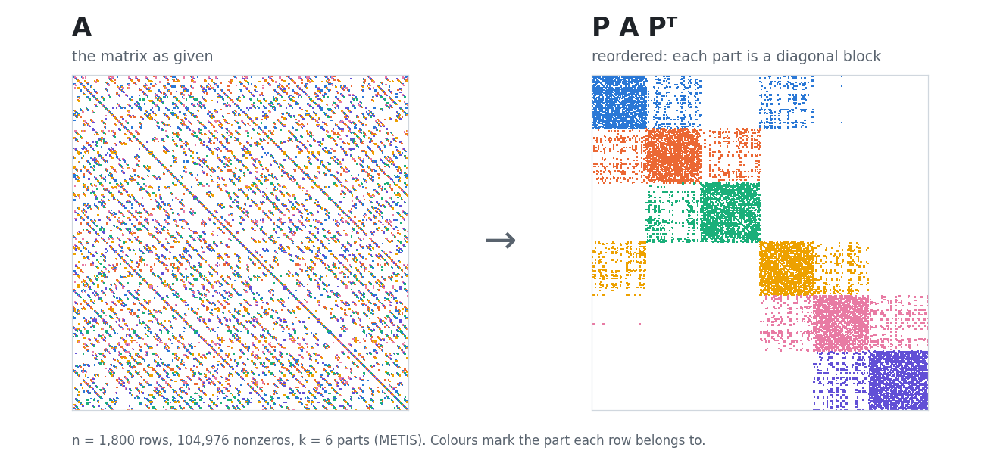
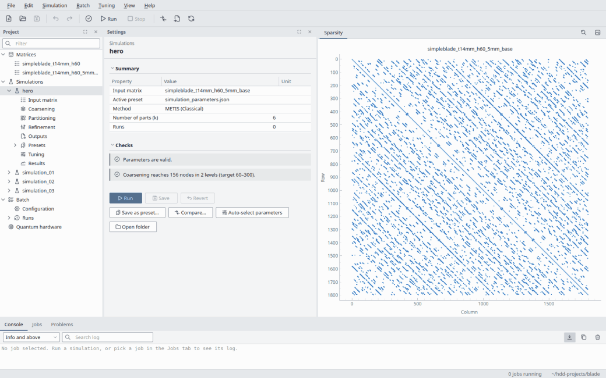
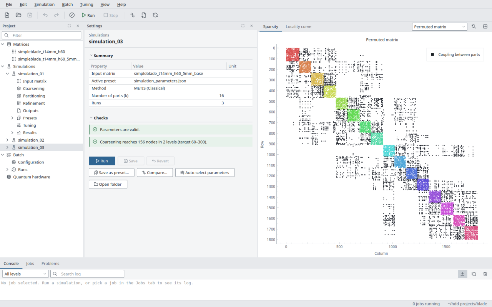
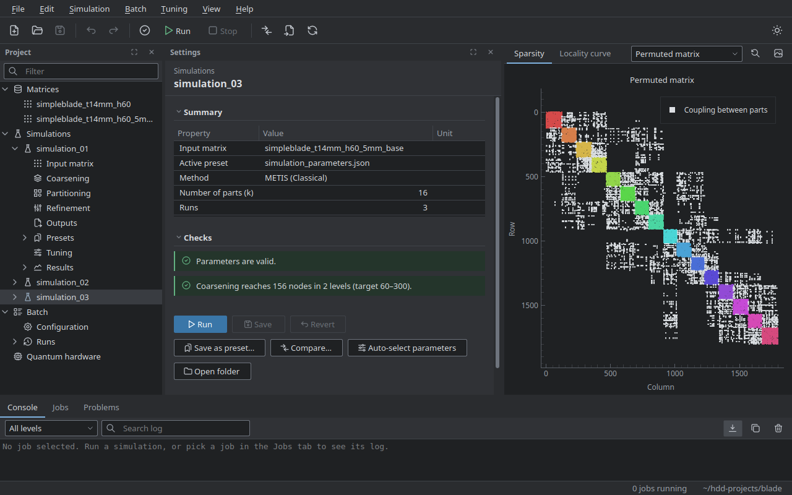

# Hybrid Domain Decomposition

Reorders any square sparse matrix (`.mtx`) into $A' = P A P^\top$ by partitioning its graph with METIS, Quantum Annealing or QAOA. Everything runs on your machine.

<br clear="left">



## Install

```sh
git clone https://github.com/orlandomotapires/hybrid_domain_decomposition.git
cd hybrid_domain_decomposition

conda create -n hdd python=3.14 -y
conda activate hdd

pip install -e ".[gui]"
packaging/linux/install-launcher.sh      # add HDD Studio to the application menu (--remove to undo)
```

## Run

```sh
./run.sh                                       # open the desktop app
./run.sh --desktop --workspace ~/hdd-projects/blade

./run.sh simulations/simulation_01             # run one simulation
./run.sh --run_batch                           # run the batch study
./run.sh --tune simulations/simulation_01 --auto
```

Running a simulation from the desktop app: the log streams in the console, then the run opens with its reordered matrix and locality curve.

<picture>
  <source media="(prefers-color-scheme: dark)" srcset="docs/wiki/images/run-simulation-dark.gif">
  
</picture>

The app has a light and a dark theme: switch with the sun/moon button at the right of the tool bar (Ctrl+Shift+L). On GitHub the pictures follow your theme; both are shown here:

| Light | Dark |
| --- | --- |
|  |  |

## Test

```sh
pip install -e ".[gui,dev]"
QT_QPA_PLATFORM=offscreen python -m pytest
```

## Documentation

The [wiki](docs/wiki/README.md) explains [how the pipeline works](docs/wiki/how-it-works.md), the [desktop app](docs/wiki/desktop-app.md), the [command line](docs/wiki/command-line.md), [batch studies](docs/wiki/batch-studies.md), [parameter tuning](docs/wiki/parameter-tuning.md) and every [parameter](docs/wiki/parameter-reference.md).

## License

[MIT](LICENSE)
