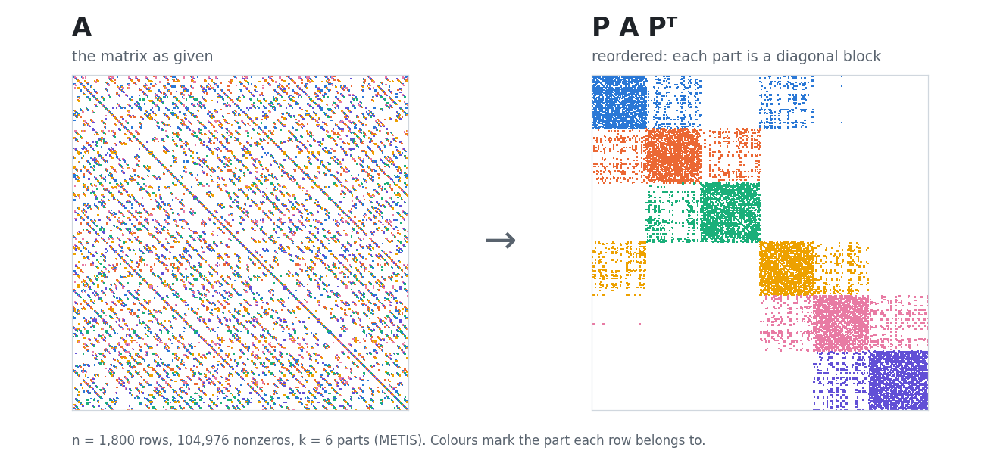

# Hybrid Domain Decomposition wiki

Reorders a square sparse matrix $A$ into $A' = P A P^\top$ by partitioning its graph, classically with METIS or with quantum methods (annealing on D-Wave, QAOA on QLM), so that its nonzeros gather in diagonal blocks. It runs on your machine, from a desktop app or the command line.

 

## Start here

- [Installation](installation.md): environment, dependencies, application-menu launcher, troubleshooting.
- [How it works](how-it-works.md): the five pipeline stages and what a run writes.

## Use it

- [Desktop app](desktop-app.md): the window, every page, shortcuts, jobs that keep running.
- [Command line](command-line.md): every `run.sh` command.
- [Simulations](simulations.md): configuring a pipeline run and its presets.
- [Matrix library](matrix-library.md): adding and generating matrices.
- [Batch studies](batch-studies.md): many matrices × methods × scales in one go.
- [Parameter tuning](parameter-tuning.md): automatic selection and Optuna studies.
- [Workspaces](workspaces.md): keeping project data outside the repository.
- [Quantum backends](quantum-backends.md): D-Wave Leap and QLM access.

## Reference

- [Parameter reference](parameter-reference.md): every parameter, method, output and metric (the same text as the app's F1 help).
- [Development](development.md): code layout, architecture, tests, job protocol.

The method itself is described in the [paper](../Hybrid_Quantum_Classical_Graph_Partitioning_Algorithm_for_Domain_Decomposition.pdf).
