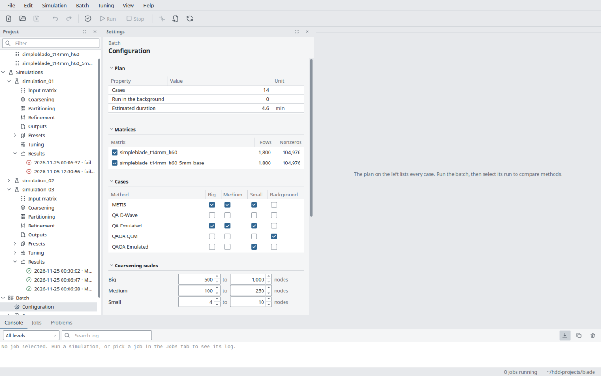
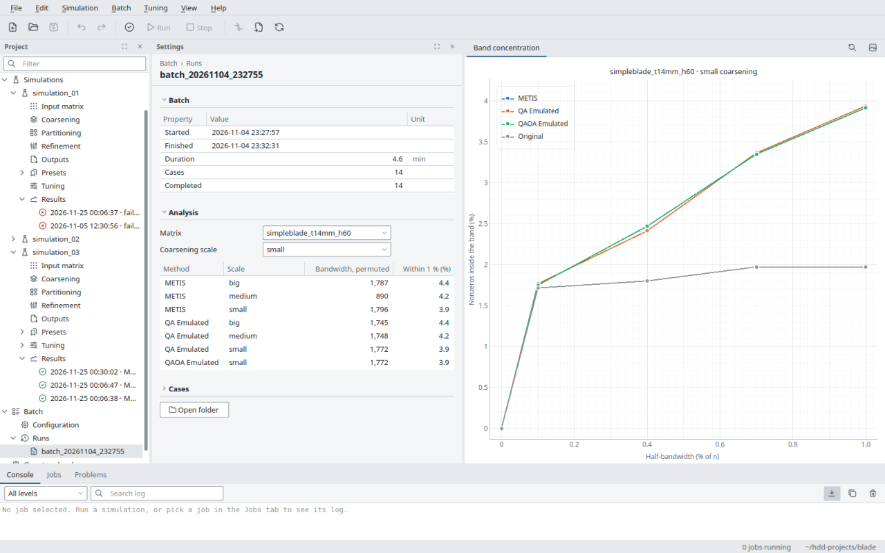

# Batch studies

A batch runs every combination of matrices × partitioning methods × coarsening scales and collects the results side by side. It uses matrices from the [library](matrix-library.md) directly and ignores the simulations' settings.

## Configure

The configuration is `batch/batch_configuration.json`. Edit it in the desktop app (**Batch → Configuration** in the project tree) or by hand.



| Key | Meaning |
| --- | --- |
| `matrices` | The library matrices to run: `[{"key": "<matrix_id>"}, …]` |
| `coarsening_presets` | Named coarse-graph ranges, e.g. `{"key": "medium", "coarsen_inferior_limit": 100, "coarsen_superior_limit": 250}` |
| `algorithm_presets` | One entry per method: `key`, `partitioning_strategy`, `allowed_sizes` (the scales it runs at) and its `strategy_parameters` |
| `async_remote_case_keys` | Remote QPU methods whose cases are submitted and collected later, so the rest of the batch does not wait for the queue |
| `base_parameters` | The full parameter set every case starts from |
| `common_defaults` | Overrides applied to every case (seed, k, balance tolerance, coarsening ratio, levels, matching strategy) |
| `save_output` | Files each case writes (default: all) |

Case keys are `<matrix>__<method>__<scale>`. In the app:

- the **Plan** shows the number of cases, how many run in the background, the estimated duration (from earlier batches) and remote QPU submissions, and warns about cases whose coarse graph is too large for their backend;
- the **Cases** grid ticks which scales each method runs at;
- edits can be undone, and are saved with **Save** (Ctrl+S). **Run batch…** offers to save first.

## Run

```sh
./run.sh --run_batch --dry-run         # list the cases
./run.sh --run_batch                   # run them
./run.sh --run_batch --nohup           # run in the background
./run.sh --run_batch --stop-on-error   # stop at the first failure
```

In the app: **Batch → Run batch…**, which shows the plan and asks for confirmation. The batch then appears in the **Jobs** panel with its case count.

## Results

Each batch writes `batch/runs/batch_<timestamp>/`:

| Path | Content |
| --- | --- |
| `batch_manifest.json` | Every case, its status, times and result folder |
| `batch_summary.json` | Bandwidth and locality metrics per completed case |
| `batch.log` | The batch's output; ends with `Batch finished: …`, failed cases appear as `FAILED:` lines |
| `cases/<case_key>/` | Each case's run folder |
| `batch_configuration.json` | A copy of the configuration that ran |

In the app, select the batch under **Batch → Runs**: the page lists the cases and, for a chosen matrix and coarsening scale, plots each method's band concentration against the original ordering.


