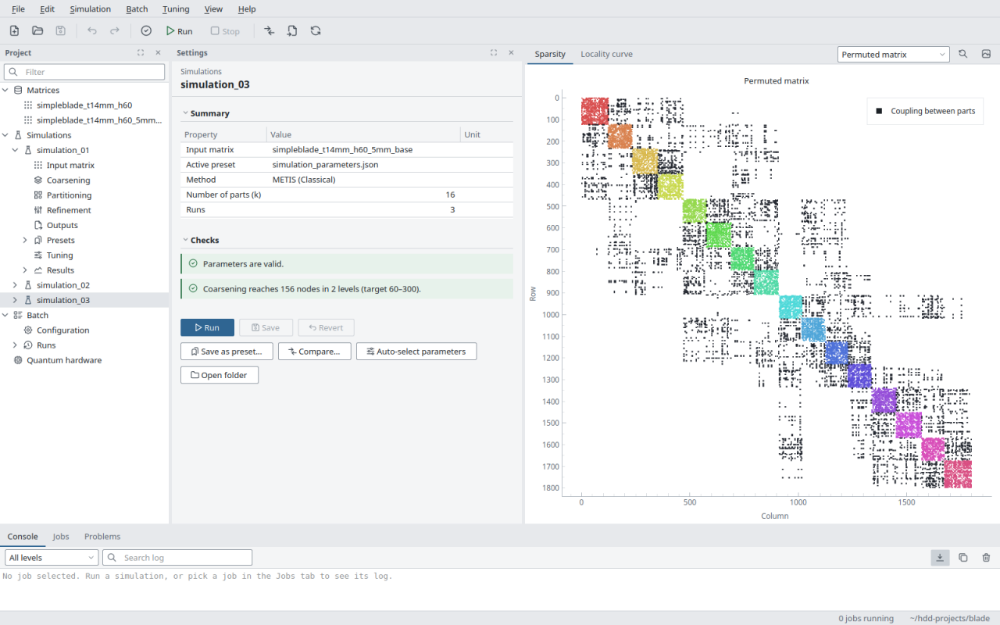
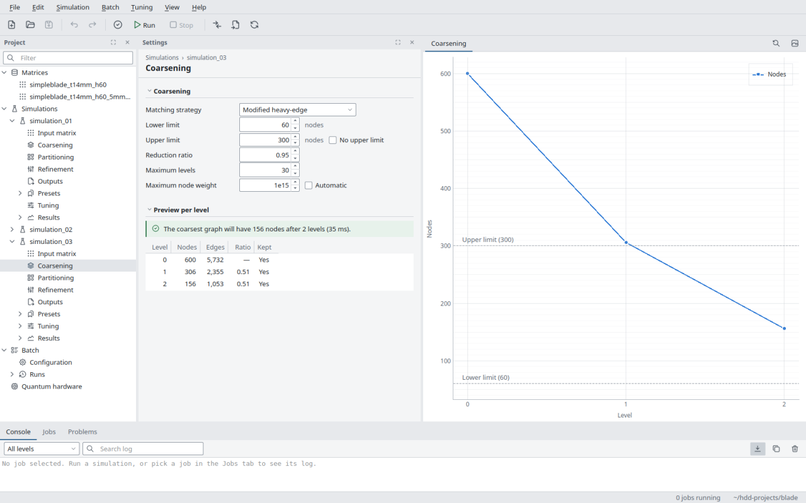
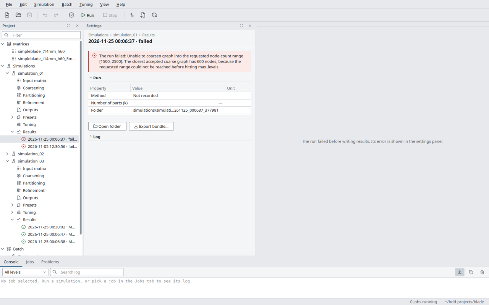
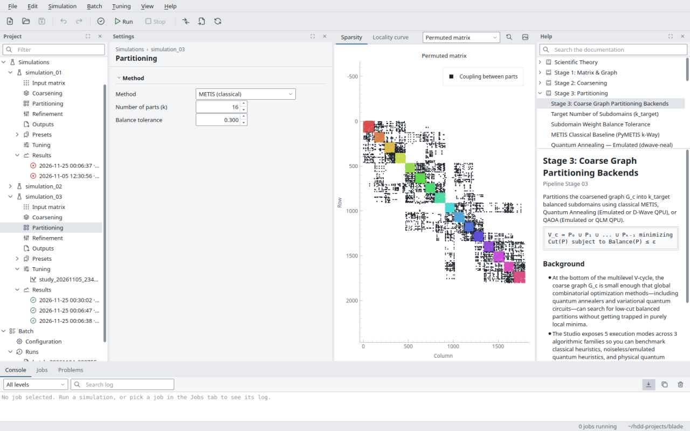
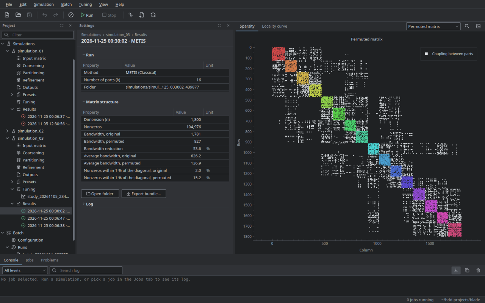

# Desktop app

HDD Studio is a native Qt 6 app. Start it with `./run.sh` (or from the application menu, see [Installation](installation.md)). It opens the last workspace you used; `./run.sh --desktop --workspace DIR` opens another one, and `--theme light|dark|system` overrides the theme for one session.

## The window

- **Project** (left): the workspace as a tree — matrices, simulations with their stages, presets, tuning studies and runs, the batch configuration and batch runs, and the quantum hardware checks. Type in the filter box to narrow it.
- **Settings** (middle): the page of the selected item. Simulation pages are editors; the others show information and actions.
- **Plots** (right): the selected item's plot. Pages without a plot of their own show the simulation's latest successful run (or its input matrix before the first run), with a caption saying what is shown. Use the magnifier to fit the plot and the image button to export it as PNG, SVG or CSV.
- **Console, Jobs, Problems** (bottom): the live log of the followed job, every job with its state and progress, and the validation errors of open simulations. Double-click a problem to jump to its field.
- **Help** (right, opened with F1): the documentation, opened at the parameter that has the focus.

Every panel can be moved, floated, tabbed or closed; **View → Reset layout** restores the default, and the layout is remembered between sessions. **View → Theme** switches between light, dark and the system setting.

## Pages

| Item | What you can do |
| --- | --- |
| **Matrices** → matrix | See its header (dimension, nonzeros, density, symmetry) and sparsity pattern; delete it when nothing uses it |
| **Simulation** | Run it, save, revert, save as preset, compare parameters, auto-select parameters. The **Checks** section says whether the parameters are valid and whether the coarsening can reach its target range on this matrix |
| ↳ **Input matrix** | Pick the library matrix and the block size (rows per graph node), set the random seed |
| ↳ **Coarsening** | Edit the matching strategy and limits; a dry run previews every level as you type, in a table and a plot |
| ↳ **Partitioning** | Choose the method (METIS, quantum annealing, QAOA; emulated or hardware), k and the balance tolerance; quantum methods show their QPU workload estimate |
| ↳ **Refinement**, **Outputs** | Edit the refinement objective and limits; choose which files each run writes |
| ↳ **Presets** | Load, activate, compare and delete parameter presets |
| ↳ **Tuning** → study | Create studies, follow their trials, stop, resume, apply the best parameters (see [Parameter tuning](parameter-tuning.md)) |
| ↳ **Results** → run | KPIs, permuted matrix and locality curve; compare up to five runs; open the folder or export a `.zip` bundle. A failed run shows its error and its log |
| **Batch** → Configuration | Edit the batch (see [Batch studies](batch-studies.md)) and run it |
| **Batch** → Runs → run | Cases and their status; band concentration per method, for a chosen matrix and coarsening scale |
| **Quantum hardware** | Installed SDKs and credentials per backend; probe D-Wave Leap and QLM |

## Editing

Parameter edits are kept in memory until you save (**Ctrl+S**). The header shows **● Unsaved changes**; undo and redo work per simulation. Fields are checked as you type and errors appear under the field and in the **Problems** panel; a simulation with errors cannot be saved or run. Running a simulation with unsaved changes asks whether to save first or run the edited parameters without saving them. Quitting or switching workspace with unsaved changes asks too.

## Jobs

Simulations, batches and tuning studies run as separate processes, so the window stays responsive and a job can be stopped at any time (**Shift+F5** stops the job shown in the console). Each job keeps a record and a log in `<workspace>/.hdd/jobs/` (a batch's log is `batch/runs/<batch>/batch.log`).

Jobs keep running when you quit: the app asks whether to keep them running (the default) or stop them. When you open the workspace again, running jobs are followed again, and jobs that finished meanwhile show how they ended.

The status bar shows the followed job's stage and progress: pipeline stage for a simulation, cases for a batch, trials for a tuning study.

## Shortcuts

| Key | Action |
| --- | --- |
| F5 / Shift+F5 | Run the selected simulation / stop the followed job |
| Ctrl+S | Save |
| Ctrl+Z / Ctrl+Shift+Z | Undo / redo |
| F6 | Preview the coarsening |
| F7 | Check parameters |
| F1 | Documentation for the focused parameter or the selected item |
| Ctrl+Shift+N | New simulation |
| Ctrl+N / Ctrl+O | New / open workspace |
| Ctrl+R | Reload the workspace from disk |

The dark theme uses the same layout and colours for data:

