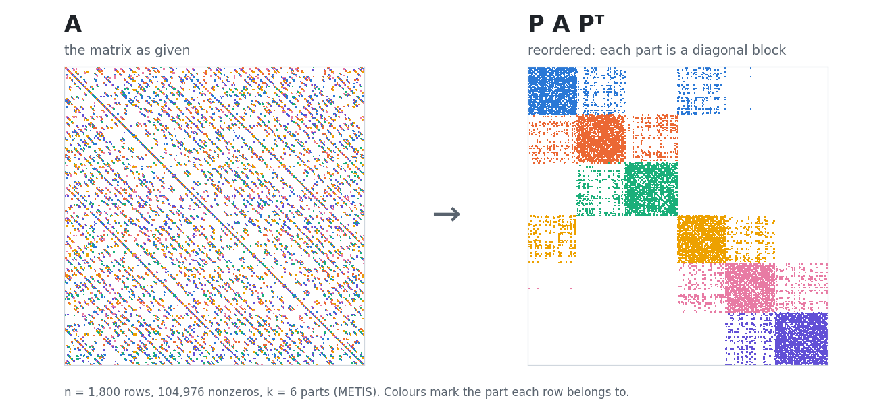

# How it works

A run takes one square sparse matrix $A$ and returns a permutation $P$ and the reordered matrix $A' = P A P^\top$, whose nonzeros sit in $k$ diagonal blocks with little coupling between them. It is a multilevel scheme: shrink the matrix graph, partition the small graph, then project the partition back.

Each colour is one part. On the left, rows of every part are spread through the matrix; after reordering, each part's rows are numbered together, so its nonzeros form a diagonal block and only the coupling between parts stays off the diagonal.

## The five stages

1. **Graph construction.** $A$ becomes a weighted undirected graph $G_0$: one vertex per row, or per block of `dof_per_node` rows that must stay together (for example 3 degrees of freedom per mesh node in 3D FEM). Vertex weights come from the diagonal, edge weights from the off-diagonal magnitudes.
2. **Coarsening.** Heavy-Edge Matching contracts $G_0 \to G_1 \to \dots \to G_L$, merging strongly connected vertex pairs, until the vertex count falls inside `[coarsen_inferior_limit, coarsen_superior_limit]`. Matching strategies: heavy-edge sorted or random, modified heavy-edge, light-edge.
3. **Coarse partitioning.** The small graph $G_L$ is split into $k$ balanced parts with minimal edge cut:
   - **METIS**, the classical baseline;
   - **Quantum annealing**: recursive bipartitions, each a balanced-cut QUBO, on a local simulated annealer or a D-Wave QPU;
   - **QAOA**: the same recursive bipartitions as an Ising problem, on a local PennyLane emulator or a QLM QPU.
4. **Uncoarsening and refinement.** The partition is projected back level by level to $G_0$, with Kernighan–Lin boundary moves at each level that lower the cut (`cut`) or the cut plus imbalance (`cut_balance`).
5. **Permutation.** Unknowns are numbered contiguously by part, giving $P$ and $A' = P A P^\top$, and the run measures bandwidth, average bandwidth, $nB^2$ and how many nonzeros lie near the diagonal.

Quantum backends only see the coarse graph, so its size has to fit the hardware: the app and the [batch planner](batch-studies.md) warn when a coarsening range is too large for the chosen backend.

## What a run writes

Each run gets a folder `simulations/<simulation>/results/run_<timestamp>/`:

| File | Content | Written |
| --- | --- | --- |
| `run_log` | Everything the run logged | Always |
| `run_inputs.json` | The exact matrix file used | Always |
| `decomposition_metrics.json` | Edge cut, imbalance, coarse-graph size, levels, time per stage | Always (when the run gets that far) |
| `run_metrics.json`, `.txt` | Bandwidth and locality metrics of $A$ and $A'$ | `run_metrics` output |
| `matrix_permuted.mtx` | $A'$ | `matrix_permuted` output |
| `permutation.txt` | $P$ | `permutation` output |
| `coarsened_graph.mtx` | The coarse graph | `coarsened_graph` output |
| `run_simulation_parameters.json` | The parameters actually used | `run_simulation_parameters` output |

The optional outputs are chosen per simulation (`save_output` in its configuration, or its **Outputs** page). Plots of a run need the permuted matrix, the permutation and the coarsened graph. Every run is also appended to `tuning/history.jsonl`, which [parameter tuning](parameter-tuning.md) uses as a warm start.

## Code

The pipeline lives in `src/libs/`: `domain_decomposition.py` runs the stages, `multilevel_scheme/` holds coarsening, partitioning (METIS, `qa/`, `qaoa/`) and uncoarsening, `permutation.py` and `profiling/matrix_metrics.py` build $A'$ and its metrics. See [Development](development.md) for the rest of the code, and the [parameter reference](parameter-reference.md) for every parameter and formula.
