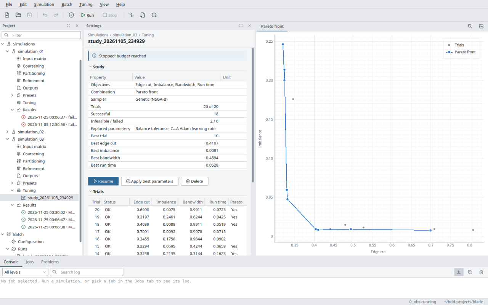

# Parameter tuning

Two ways to choose a simulation's parameters:

- **Automatic selection** proposes one feasible parameter set in seconds, from rules on the matrix's features and a dry run of the coarsening.
- **Studies** run the pipeline many times with [Optuna](https://optuna.org), searching the parameters that best meet one or more objectives.

## Objectives

| Objective | Measures (lower is better) |
| --- | --- |
| Edge cut | Cut weight / total edge weight of the fine graph |
| Imbalance | Heaviest part / ideal part weight − 1 |
| Band quality | 1 − fraction of nonzeros near the diagonal of the reordered matrix |
| Bandwidth | Bandwidth of the reordered matrix / n |
| Run time | Wall time of the pipeline |

Several objectives are either kept as a **Pareto front** (every trade-off no other trial beats on all objectives) or combined into a **weighted sum**.

## Samplers

Auto (NSGA-II for a Pareto study, TPE otherwise), Bayesian (TPE), Genetic (NSGA-II), CMA-ES (single objective), Quasi-random (Sobol) and Random.

## Search space

Each parameter is fixed (kept at the simulation's value) or free (explored within a range or a set of choices): partitioning method, k, balance tolerance, coarse-graph target size and window, matching strategy, coarsening ratio, maximum levels, refinement settings, and the annealing and QAOA settings. Coarsening is searched as a target size for the coarse graph, so trials do not waste time on unreachable ranges; parameter sets that cannot work are rejected before running.

## In the desktop app

- **Tuning → Auto-select parameters** loads the proposed parameters into the editor, with the reasons, without saving them.
- **Tuning → New study…** (or **New study…** on a simulation's Tuning page) opens a dialog for objectives, sampler, number of trials, runs per trial and the parameters to explore, and starts the study as a job.
- A study's page shows its settings, the best values and every trial; the plot shows the Pareto front of the first two objectives, or the best score per trial. **Stop after this trial**, **Resume**, **Apply best parameters** (writes them into the simulation) and **Delete** are on the same page.



## Command line

```sh
./run.sh --tune simulations/simulation_01 --auto                                      # automatic selection only
./run.sh --tune simulations/simulation_01 --n-trials 30 --objectives edge_cut,imbalance   # Pareto study (NSGA-II)
./run.sh --tune simulations/simulation_01 --objectives edge_cut \
        --free k_target,partitioning_strategy --sampler tpe                          # one objective, k and method free
./run.sh --tune --resume simulations/simulation_01/tuning/study_<timestamp>           # continue a study
```

| Option | Meaning |
| --- | --- |
| `--auto` | Print the automatic selection and stop |
| `--objectives` | Comma-separated: `edge_cut`, `imbalance`, `band_quality`, `bandwidth`, `time` |
| `--aggregation` | `pareto` or `weighted` |
| `--sampler` | `auto`, `tpe`, `nsga2`, `cmaes`, `qmc`, `random` |
| `--n-trials` | Number of trials |
| `--repeats` | Runs per trial with different seeds (objectives are averaged) |
| `--timeout-sec`, `--patience` | Stop after a time, or after this many trials without improvement |
| `--free`, `--fixed` | Comma-separated search-space keys to explore or fix |
| `--config` | A JSON file with any of the above, including a full `search_space` |
| `--resume` | Continue an existing study folder |

## Where studies are stored

```text
simulations/<simulation>/tuning/study_<timestamp>/
    study_config.json      what was asked for (objectives, sampler, search space, budget)
    study.db               Optuna storage (SQLite), so a study can be resumed
    trials.jsonl           one line per trial: parameters, objective values, status
    summary.json           progress, best trial or Pareto front
    best_parameters.json   the best trial's parameters (the "knee" of a Pareto front)
    trials/trial_000/...   each trial's normal run folder
```

Every run, from any interface, is also appended to `tuning/history.jsonl`. New studies use it as a warm start, together with the simulation's current parameters and the automatic selection. The code is in `src/libs/tuning/`.
